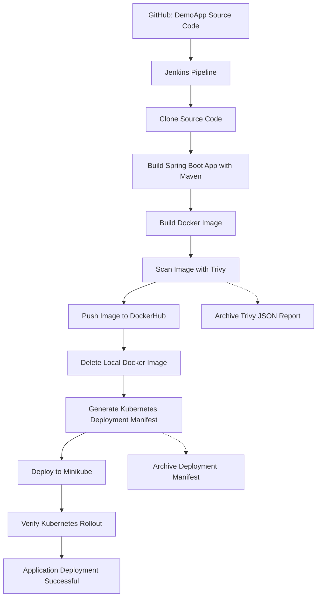

# Jenkins CI/CD Pipeline Architecture

## Workflow

## Component Responsibilities

| Component | Responsibility |
|---|---|
| GitHub | Hosts the application source code |
| Jenkins | Orchestrates the CI/CD workflow |
| Maven | Builds the Spring Boot application |
| Docker | Packages the application into an image |
| Trivy | Scans the image for vulnerabilities |
| DockerHub | Stores the published container image |
| Kubernetes | Manages application deployment and replicas |
| Minikube | Provides the local Kubernetes cluster |

## Image Flow

The Docker image is tagged using the DockerHub username and Jenkins build number.

Example:

`alshaimaamo/demoapp:2`

After the image is pushed to DockerHub, Jenkins removes the local image and Kubernetes pulls the published image using the deployment manifest.

## Deployment Verification

Jenkins checks the rollout status of `demoapp-lab21` in the `ivolve` namespace and retrieves deployment and pod information.
